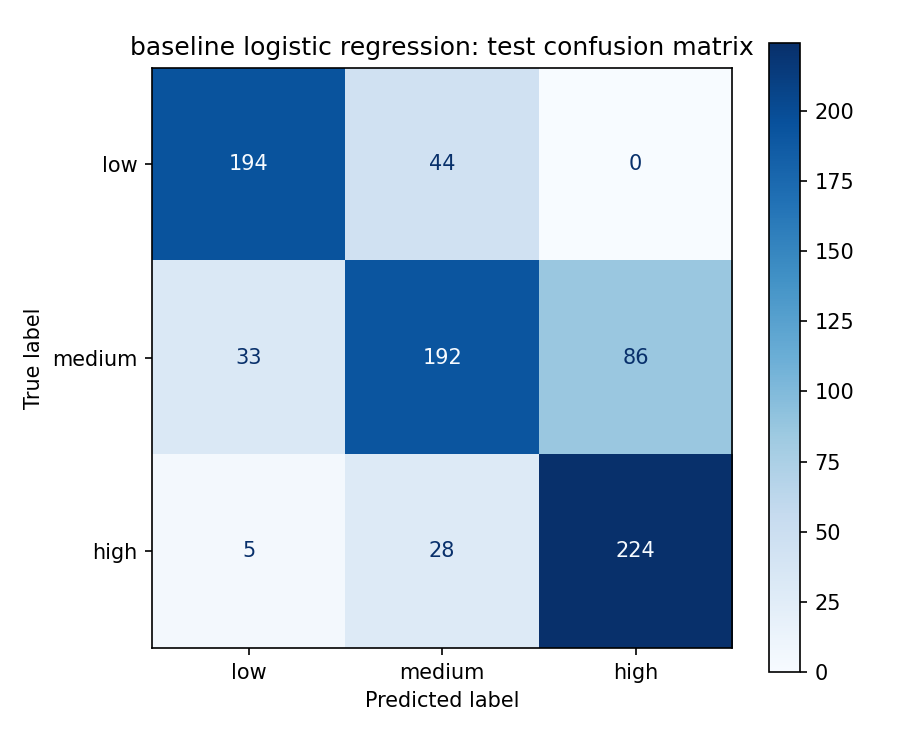

# Assessing Football Stadium Attendance and Experience During the Regular Season

Predicting whether an FBS college football home game will have **low, medium, or high stadium turnout** relative to capacity, using game, matchup, stadium, and historical attendance data from the 2023-2025 regular seasons.

---

### 👥 **Team Members**

| Name               | Email                                                     | Contribution |
|--------------------|-----------------------------------------------------------|--------------|
| Emirlan Asanakunov | [asnkunv@gmail.com](mailto:asnkunv@gmail.com)             |              |
| Hiba Belhaj        | [belhaj1h@alma.edu](mailto:belhaj1h@alma.edu)             |              |
| Ahana Majumdar     | [ahm228@lehigh.edu](mailto:ahm228@lehigh.edu)             |              |
| Susmita Pasala     | [susmitapasala@gmail.com](mailto:susmitapasala@gmail.com) |              |
| Donovan Heggs      | [dheggs1@Isu.edu](mailto:dheggs1@Isu.edu)                 |              |

---

## 🎯 **Project Highlights**

- Built a three-class classification model (low, medium, high turnout) that predicts stadium turnout for FBS home games before kickoff, using only pre-game information.
- The selected **tuned Random Forest** reached **0.771 macro F1, 76.8% accuracy and 0.911 ROC AUC** on the held-out 2025 season, compared with 0.152 macro F1 for a majority-class baseline. Tuned XGBoost performed equally well (0.776 macro F1), and both were kept as the leading models.
- Cleaned and validated 11,087 raw games down to 2,365 FBS home games with reliable attendance and stadium capacity, fixing team-name mismatches, outdated stadiums, and outdated capacities.
- Engineered leakage-safe features (kickoff slot, Elo matchup strength, travel distance, prior turnout history) and used a **time-based split** and **season-grouped cross-validation**, so the model is always evaluated on a season it has not seen.
- Found that a program's own turnout history, stadium size, and matchup quality are the strongest signals, which gives athletic departments concrete levers to look at when planning their gameday strategy.

---

## 👩🏽‍💻 **Setup and Installation**

**1. Clone the repository**

```bash
git clone https://github.com/Break-Through-Tech/Sports-Analytics-1B-assessing-football-stadium-attendance-and-experience.git
cd Sports-Analytics-1B-assessing-football-stadium-attendance-and-experience
```

**2. Create and activate a virtual environment** (Python 3.11+ recommended)

```bash
python -m venv bttenv
# macOS / Linux
source bttenv/bin/activate
# Windows
bttenv\Scripts\activate
```

**3. Install dependencies**

```bash
pip install -r requirements.txt
pip install xgboost
```

`xgboost` is used in `03_candidate_models.ipynb`. The saved models were trained with scikit-learn 1.9.1, xgboost 3.4.1, pandas 3.0.6 and joblib 1.6.0, and the `.joblib` files should be loaded with the same versions.

**4. Access the data**

All datasets used by the notebooks are already committed under `data/`, so no API key is needed to reproduce the results. To re-download the game data from the College Football Data (CFBD) API:

1. Get a free key at https://collegefootballdata.com/key (register with your `.edu` email for the Academic tier).
2. Create a `.env` file in the project root containing:
   ```
   CFBD_API_KEY=your_key_here
   ```
3. Run the fetch script from the project root:
   ```bash
   python data_fetch.py
   ```
   This saves the 2023-2025 regular-season games to `data/raw/cfbd_games_2023_2025.csv`.

**5. Run the notebooks**

Start Jupyter and run the notebooks in order from the `notebooks/` folder:

```bash
jupyter lab
```

| Order | Notebook | What it does | Outputs |
|-------|----------|--------------|---------|
| 1 | `01_eda_feature_engineering.ipynb` | EDA, data cleaning, feature engineering, target definition, train/test split | `data/processed/cleaned_fbs_games.csv`, `data/processed/features/` |
| 2 | `02_baseline_model.ipynb` | Logistic regression baseline vs. majority-class dummy | `data/train_test_df/`, `results/baseline/` |
| 3 | `03_candidate_models.ipynb` | Candidate models, season-grouped CV, hyperparameter tuning, model selection, test evaluation | `results/candidate_models/` |

**Project structure**

```
├── data_fetch.py                 # Pulls 2023-2025 regular-season games from the CFBD API
├── requirements.txt
├── data/
│   ├── raw/                      # CFBD game data and stadium capacity/location datasets
│   ├── processed/
│   │   ├── cleaned_fbs_games.csv # Cleaned FBS home games
│   │   └── features/             # Encoded train/test features, fitted preprocessor, feature config
│   └── train_test_df/            # X/y train and test splits
├── notebooks/
│   ├── 01_eda_feature_engineering.ipynb
│   ├── 02_baseline_model.ipynb
│   └── 03_candidate_models.ipynb
└── results/
    ├── baseline/                 # Baseline metrics, confusion matrix, predictions, model
    └── candidate_models/         # CV and test comparisons, best params, tuned RF and XGBoost models
```

---

## 🏗️ **Project Overview**

This project was completed as part of the **Break Through Tech AI Program**, through the AI Studio Challenge Project in Fall 2026. AI Studio pairs Fellows with a Challenge Advisor to solve a real-world machine learning problem over one semester.

**Host organization and objective:** Our host is an independent sports analytics initiative focused on improving fan engagement through data-driven insights. College football stadiums vary widely in attendance from game to game: some games fill nearly every seat, while others draw only a fraction of capacity. The objective was to use college football game and venue data to build a classification model that predicts how full a stadium will be for a home game, and to identify which factors contribute to a strong gameday turnout.

**Scope:** The project covers FBS home games from the 2023, 2024 and 2025 regular seasons. The original challenge framed the task as binary (high vs. low turnout). The team chose a **three-class target (low, medium, high)** so that the many sold-out games are separated from games that are well attended but not full, and from games with clearly weak turnout.

**Real-world significance:** Empty seats mean lost ticket, concession and parking revenue, and a weaker atmosphere for fans and players. A model that flags which upcoming games are at risk of low turnout lets athletic departments act early, for example through targeted promotions, ticket pricing, scheduling decisions, or student-section incentives. The feature analysis also shows which factors (opponent quality, kickoff time, day of week, travel distance) are associated with turnout, which can inform longer-term scheduling strategy.

---

## 📊 **Data Exploration**

**Datasets used**

| Dataset | Source | Format | Size |
|---------|--------|--------|------|
| Regular-season games, 2023-2025 | [College Football Data (CFBD) API](https://collegefootballdata.com) `/games` endpoint | JSON exported to CSV | 11,087 games, 34 columns |
| FBS and FCS stadiums | Stadium capacity and location tables | CSV | 250 FBS and 152 FCS stadiums |
| Geocoded stadiums | Stadium capacity, team, latitude and longitude | CSV | 253 stadiums |

The game data includes teams, conferences, kickoff time, venue, attendance, pre-game and post-game Elo ratings, scores and win probabilities. The stadium data provides capacity and location, which are needed to turn raw attendance into turnout relative to capacity.

**Key EDA insights**

- Attendance is missing for 64% of all games, but the missingness is structured: FBS home games report attendance 98.3% of the time, FCS 64%, and Division II and III almost never.
- Reported attendance is strongly right-skewed (median about 20,200, mean about 30,100, maximum 111,373).
- Median attendance is highest in Weeks 1-2 (about 27,000) and lower in the middle of the season.
- Raw attendance differs hugely by conference (SEC median about 83,300, MAC about 13,100), which mostly reflects stadium size. This is why the target is based on **attendance relative to capacity** rather than raw attendance.
- Exact team-name matching only connected 86% of FBS games to a stadium, and only 1.8% of FCS games, so the analysis focuses on FBS.
- 459 games reported attendance above listed capacity, which pointed to outdated capacity values rather than bad attendance data.

**Data cleaning**

| Step | Decision | Reason |
|------|----------|--------|
| Scope | Kept completed FBS home games with reported attendance | Only FBS has enough attendance and capacity data. Attendance is the target, so it is not imputed |
| Neutral sites | Removed | The home team's stadium capacity does not apply at a neutral venue |
| Team names | Mapped 20 differently named schools (e.g., "Ole Miss" vs. "Mississippi"), removed UAB | Connects the game and stadium data without guessing |
| Wrong stadium | Removed games for teams whose listed stadium is no longer used (e.g., Georgia State, Hawai'i, UNLV, San Diego State) | Their capacities belong to a different building |
| Outdated capacity | Replaced capacity with the highest observed attendance for Coastal Carolina, App State, Kennesaw State and Utah | Their typical crowd was far above listed capacity, showing the stadium had been expanded |
| Outliers | Removed games above 125% of capacity, capped turnout at 100% | Removes likely data-entry errors while keeping real sellouts |
| Missing values | Filled missing away Elo (FCS opponents) with the minimum Elo plus a flag, dropped empty columns | Keeps as many games as possible with transparent fills |

Result: **2,365 cleaned FBS home games**, saved as `data/processed/cleaned_fbs_games.csv`.

**Feature engineering**

All post-game columns (scores, post-game Elo, post-game win probability, excitement index) were excluded to prevent data leakage. The final set has 17 raw features (32 after encoding):

| Group | Features |
|-------|----------|
| Kickoff time | `week`, `day_type` (Saturday, Friday, other), `kickoff_slot` (midday, afternoon, evening, late, unknown), using an approximate local time instead of UTC |
| Matchup | `conferenceGame`, `away_is_fcs` |
| Team strength | `homePregameElo`, `elo_diff`, `elo_abs_diff` |
| Stadium and travel | `log_capacity`, `latitude`, `longitude`, `away_travel_km` (haversine distance) |
| Historical demand | `home_prior_turnout`, `home_turnout_trend`, `home_prior_games`, `away_draw_lift_prior`, all computed only from earlier games |
| Conference | `homeConference` (one-hot encoded) |

**Challenges and assumptions**

- The stadium data was partly outdated, so several teams had to be removed or have their capacities corrected.
- Elo is only available for FBS teams, so FCS opponents were assigned the lowest observed Elo and marked with `away_is_fcs`.
- Turnout above 100% (standing room, student sections) was capped at 100%, so every sold-out game counts as "full".

---

## 🧠 **Model Development**

**Target definition**

`turnout_rate = attendance / capacity` was split into three classes using the 1/3 and 2/3 quantiles of the **training set only**, which gives classes of similar size:

| Class | Code | Turnout rate |
|-------|------|--------------|
| Low | 0 | up to 70.1% |
| Medium | 1 | 70.1% to 96.0% |
| High | 2 | above 96.0% (includes sold-out games) |

The thresholds are saved in `data/processed/features/feature_config.json` so new games are labeled with the same cut points.

**Training setup**

- **Time-based split:** training on 2023-2024 (1,559 games), testing on 2025 (806 games). This mirrors real use, predicting a future season from past ones.
- **Season-grouped cross-validation:** each fold holds out one whole training season (train on 2024 and validate on 2023, then train on 2023 and validate on 2024), so no validation-season game is used in training.
- **Preprocessing:** median imputation for numeric features, one-hot encoding for categorical features (categories with fewer than 30 training games grouped as infrequent), and standard scaling for linear and kernel models. All preprocessing is fitted inside each fold to avoid leakage.
- **Main metrics:** macro F1 and balanced accuracy, because both weight the three classes equally. Accuracy, macro precision and recall, and one-vs-rest ROC AUC are also reported.

**Models**

| Model | Role |
|-------|------|
| Majority-class dummy | Lower bound |
| Logistic regression | Linear baseline |
| RBF SVM (with sigmoid calibration) | Smooth nonlinear boundary |
| Random forest | Bagged tree ensemble |
| XGBoost | Gradient boosting |
| Soft voting | Equal-weight average of the four models' probabilities |
| Stacking | Meta-learner on out-of-fold predictions (scored on test only) |

**Hyperparameter tuning**

Each individual model was tuned with a small randomized search on grouped-CV macro F1, using the training seasons only. The search was kept small on purpose, because with only two validation seasons a long search would overfit those seasons. Best parameters are saved in `results/candidate_models/best_params.json` (for example, the random forest uses `max_depth=9`, `min_samples_leaf=13`, `max_features="sqrt"`).

**Model selection**

The selection rule was fixed in advance: choose the tuned model with the highest grouped-CV macro F1, before any test-season prediction is made.

| Model (tuned) | CV accuracy | CV balanced accuracy | CV macro F1 | CV ROC AUC |
|---------------|-------------|----------------------|-------------|------------|
| **Random forest** | **0.744** | **0.743** | **0.744** | 0.889 |
| XGBoost | 0.738 | 0.737 | 0.740 | 0.890 |
| Soft voting | 0.720 | 0.720 | 0.720 | 0.883 |
| Logistic regression | 0.679 | 0.678 | 0.677 | 0.835 |
| RBF SVM | 0.683 | 0.685 | 0.677 | 0.836 |
| Dummy | 0.318 | 0.333 | 0.161 | 0.500 |

Random forest was selected. Its lead over XGBoost is only 0.004, so the two are treated as a practically tied high-performing tier, and both tuned models are saved. Random forest was also the more stable of the two across the validation seasons (0.745 and 0.742 macro F1).

---

## 📈 **Results & Key Findings**

**Test-season performance (2025, 806 games)**

| Model | Accuracy | Balanced accuracy | Macro F1 | ROC AUC (OvR) |
|-------|----------|-------------------|----------|---------------|
| **Random forest (tuned, selected)** | **0.768** | **0.778** | **0.771** | **0.911** |
| XGBoost (tuned) | 0.773 | 0.783 | 0.776 | 0.919 |
| Stacking (tuned) | 0.770 | 0.782 | 0.773 | 0.919 |
| Logistic regression baseline | 0.757 | 0.768 | 0.761 | 0.909 |
| Soft voting (tuned) | 0.757 | 0.771 | 0.759 | 0.916 |
| RBF SVM (tuned) | 0.708 | 0.733 | 0.702 | 0.879 |
| Majority-class dummy | 0.295 | 0.333 | 0.152 | 0.500 |

**Baseline confusion matrix (logistic regression, 2025)**



**Key findings**

- Every model beats the dummy baseline by a wide margin, so the engineered features carry real information about turnout.
- The selected random forest classifies about **3 out of 4 games correctly** and separates the classes well (ROC AUC 0.911).
- **Low and high turnout are predicted well.** The random forest finds 90% of low-turnout games and 77% of high-turnout games, and it never predicted high for a low-turnout game.
- **Medium turnout is the hardest class** for every model (about two thirds found), and almost all its errors go to a neighboring class. This is a feature and data limitation rather than a model choice problem.
- Tree models (random forest, XGBoost) clearly beat the linear and SVM models in cross-validation, where a model must predict an unseen season after learning from only one. On the 2025 test season the gap to the logistic regression baseline is smaller (about 0.01 macro F1), which suggests the engineered features, especially prior turnout history, already carry most of the signal.
- Random forest and XGBoost are essentially tied. Random forest is more stable across seasons, XGBoost finds slightly more medium-turnout games and scored a little higher on 2025. Both are reasonable choices.

---

## 🚀 **Next Steps**

**Limitations**

- Only three seasons of data are available, so cross-validation uses two folds and small score differences should not be over-read.
- Historical turnout features use earlier games within the same season, so the model predicts turnout as the season progresses rather than for a whole season before it starts.
- The stadium capacity data was partly outdated. Some teams were removed instead of having their capacity entered by hand, which reduces coverage.
- The analysis covers FBS home games only. FCS games could not be included because of limited stadium coverage.
- The three-class target differs from the binary framing in the original challenge, and the class thresholds depend on the training-season distribution.

**With more time and resources**

- Add **weather data** (temperature, precipitation) from [Open-Meteo](https://open-meteo.com/en/docs/historical-weather-api) for each game's location and kickoff time.
- Add **enrollment** from [IPEDS](https://nces.ed.gov/ipeds/) and **local population and income** from the [Census ACS](https://www.census.gov/data/developers/data-sets/acs-5year.html).
- Explore ticket price, betting lines, rivalry flags, homecoming games and TV network as features, focused on improving the medium class.
- Add earlier seasons to strengthen validation and verify stadium capacities so removed teams can be added back.
- Use SHAP to explain individual predictions, and build a simple dashboard that scores upcoming games for athletic departments.
- Compare the three-class model against a binary high vs. low version, and document how moving the thresholds changes the results.

---

## 📝 **License**

This project is licensed under the MIT License.

---

## 📄 **References**

- College Football Data API: https://collegefootballdata.com and https://api.collegefootballdata.com
- CFBD Python client: https://github.com/CFBD/cfbd-python
- [College Football Attendance: A Panel Study of the Football Bowl Subdivision](https://www.tandfonline.com/doi/abs/10.1080/00036846.2013.866208), Applied Economics
- [Does College Football Have an Attendance Problem?](https://athleticdirectoru.com/articles/does-college-football-have-an-attendance-problem/), Athletic Director U
- [Attendance Drops for College Football](https://www.npr.org/2019/08/24/753962604/attendance-drops-for-college-football), NPR
- scikit-learn: https://scikit-learn.org, XGBoost: https://xgboost.readthedocs.io

---

## 🙏 **Acknowledgements**

We thank our Challenge Advisor **Christina Coleman** for her guidance throughout the project, our AI Studio Coach **Bhavya Gopal** for her support, and the **Break Through Tech AI Program** for making this experience possible.
